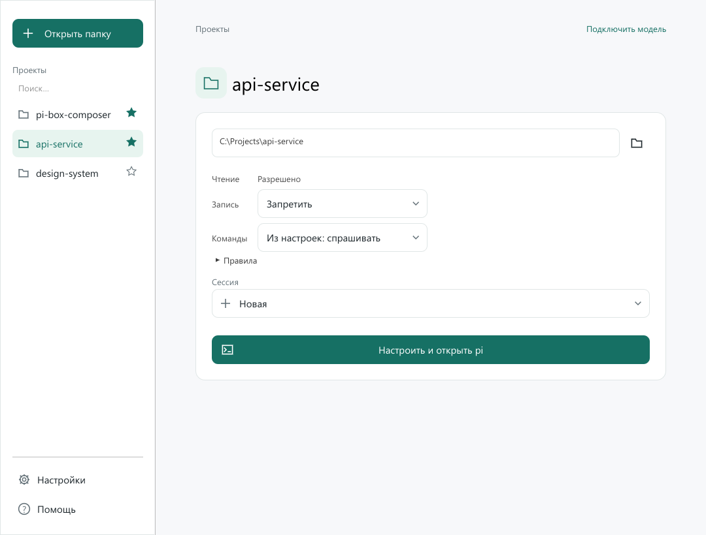
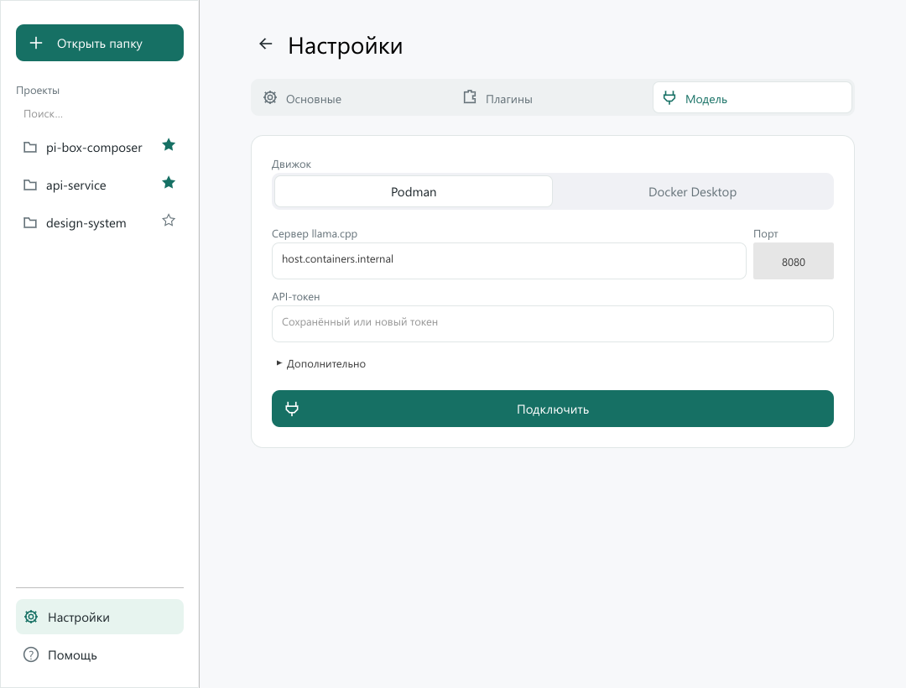
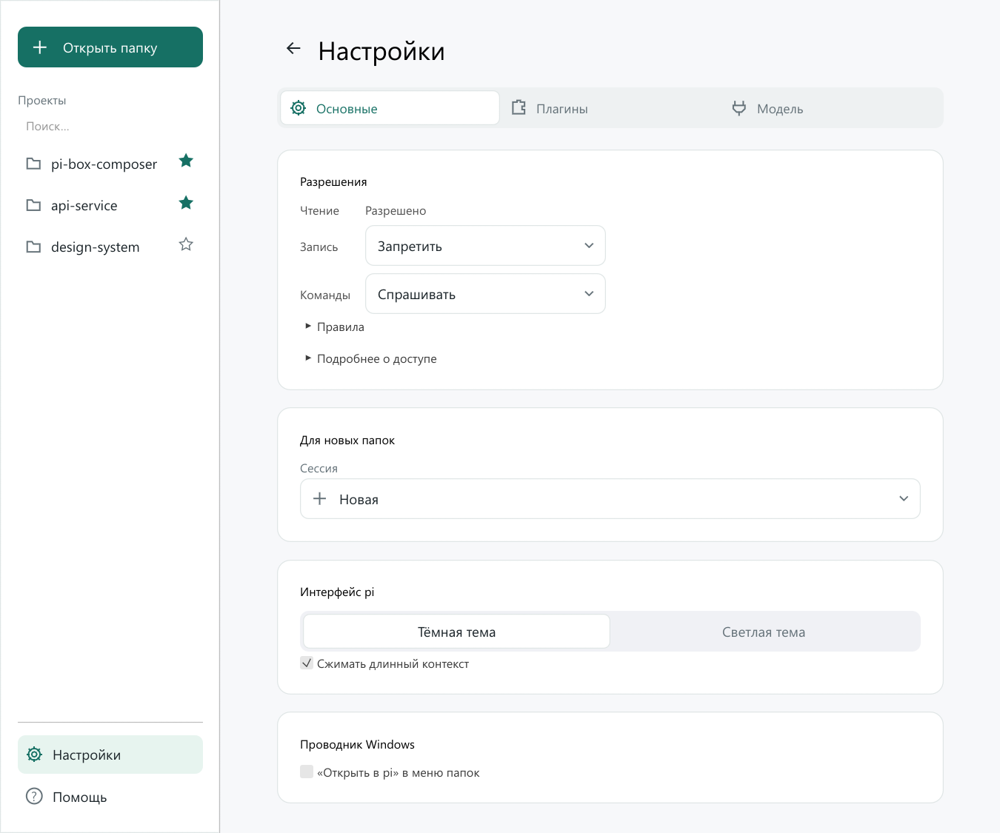
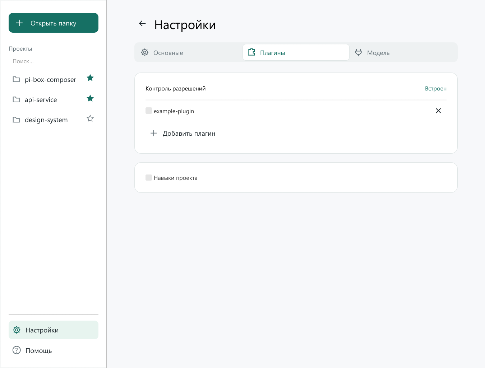
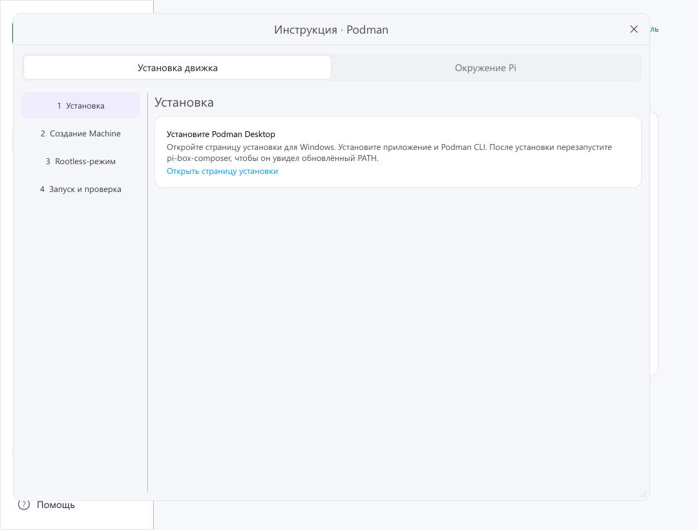

# pi-box-composer

Windows-приложение для запуска Pi в **Podman** или **Docker Desktop**. Выберите папку проекта, подключите сервер llama.cpp и задайте права агента. Версия — **0.0.6**.

## Быстрый запуск

1. Скачайте `pi-box-composer_0.0.6_windows_x64.exe` со [страницы релизов](https://github.com/lumenikoly/pi-box-composer/releases). При необходимости сверьте SHA-256 файла с `SHA256SUMS` из того же релиза.
2. Поместите EXE в постоянную папку и запустите. Установщик и Rust для готового приложения не нужны.
3. Установите Podman Desktop или Docker Desktop и подготовьте доступный сервер llama.cpp. Порядок подключения — в разделе [«Первая настройка»](#первая-настройка).

## Что нового в 0.0.6

- Новый интерфейс с боковой панелью проектов, поиском и закреплением папок.
- Раздельные настройки записи и команд, общие правила и правила отдельных проектов.
- Команда **Открыть в pi** в меню Проводника и запуск проекта через аргументы EXE.
- Открытие папки истории и удаление сессий выбранного проекта и движка с подтверждением.
- Обновлённые экраны настройки модели, параметров pi и плагинов.

Полный список изменений — в [CHANGELOG.md](CHANGELOG.md). Порядок сборки и публикации — в [инструкции релиза](docs/RELEASE.md).

## Работа с проектами

Главный экран — выбор папки и запуск pi. Нажмите **Открыть папку**, вставьте путь в поле или перетащите папку из Проводника. Настройте запись и команды, затем нажмите **Открыть pi**. Pi запускается в отдельном терминале в выбранном проекте.

- **Чтение:** разрешено в workspace, кроме путей, запрещённых политикой.
- **Запись:** запретить, спрашивать или разрешить. При запрете папка подключается только для чтения. В остальных режимах изменения сохраняются в исходной папке; подтверждения относятся к инструментам `edit` и `write`.
- **Команды:** запретить, спрашивать или разрешить bash. При доступной записи bash может изменять файлы.
- **Из настроек:** запись и команды независимо наследуют общие значения. Новые проекты используют наследование; старые сохраняют прежний режим доступа.
- **Сессии:** новая, продолжение последней или выбор прошлой внутри pi. История отделена для каждой папки и движка.
- **Недавние проекты:** поиск по имени и пути, закрепление звёздочкой, открытие двойным щелчком. Правая кнопка — открыть или убрать из списка. Удаление из списка не удаляет файлы или историю pi.
- **Удаление сессий:** правая кнопка по недавнему проекту → **Удалить сессии…**. Подтверждение показывает проект, движок и количество сессий. Сначала закройте pi этого проекта. Удаляются только файлы истории выбранного движка; настройки и файлы проекта остаются. **Открыть папку сессий** открывает её в Проводнике. Если история изменилась после открытия подтверждения, повторите удаление.
- **Права и сессия запоминаются для каждой папки.** Новые папки используют значения из настроек, а не права предыдущего проекта.
- **Клавиатура:** `Ctrl+O` — выбрать папку; `Ctrl+Enter` — запустить выбранный проект.

Папку также можно передать при запуске приложения, например из своего терминала или ярлыка:

```powershell
pi-box-composer.exe --project "C:\Projects\my-app"
pi-box-composer.exe .
```

Путь выбирает проект в интерфейсе, запуск подтверждается кнопкой **Открыть pi**.

Команда **Открыть в pi** автоматически добавляется в меню Проводника при обычном запуске launcher, в том числе при обновлении старых настроек. Она доступна в меню папки и пустого места внутри папки; в Windows 11 — в **Показать дополнительные параметры**. Команда запускает pi с сохранёнными разрешениями проекта, а при ненастроенном окружении открывает настройку. Регистрация выполняется для текущего пользователя без прав администратора. Отключить её можно в **Настройки → Основные → Проводник Windows**; выбор сохраняется. При включённой функции launcher обновляет путь к EXE при каждом запуске, поэтому после перемещения приложения достаточно открыть его заново. `--smoke-test` не меняет меню Проводника.

Для прямого запуска также доступно `pi-box-composer.exe --open "C:\Projects\my-app"`. Команда меню сохраняет путь к текущему каталогу настроек (`--data-dir`). Относительный путь разрешается от текущей папки терминала.



## Первая настройка

1. Установите [Podman Desktop](https://podman-desktop.io/docs/installation/windows-install) с rootless Machine или [Docker Desktop](https://docs.docker.com/desktop/setup/install/windows-install/) в режиме Linux containers. Команда движка должна быть доступна в PATH.
2. Выберите папку проекта и нажмите **Настроить и открыть pi**. На одном экране выберите движок, адрес llama.cpp, порт и API-токен. Для модели на этом ПК используйте `host.docker.internal` с Docker или `host.containers.internal` с Podman. Для модели в сети — адрес сервера.
3. Нажмите **Подключить**. Launcher сам проверит движок, соберёт образы, создаст сети и проверит подключение. Первый запуск занимает несколько минут. Прогресс, отмена и журнал доступны во время работы.
4. Выберите модель и нажмите **Сохранить и открыть pi**. Launcher откроет ранее выбранную папку с выбранными правами и режимом сессии.

Подключение настраивается один раз для всех проектов. Вкладка **Настройки → Модель** позволяет изменить сервер, модель и лимиты. Если настройка открыта напрямую, кнопка сохранения возвращает к проектам без автоматического запуска. В правом верхнем углу проекта показана сохранённая модель; доступность движка и модели проверяется при запуске.

В **Дополнительных параметрах** можно изменить каталог окружения или запустить установленный движок. Меню **Помощь** открывает инструкции и диагностику. Пояснения к элементам доступны при наведении.



## Настройки pi

Пункт **Настройки** содержит параметры, которые сохраняются автоматически и применяются при следующем запуске без пересборки окружения:

| Параметр | Поведение |
| --- | --- |
| Команды агента | Выключены, с подтверждением или разрешены; `sudo`, `git push` и некоторые разрушительные шаблоны остаются запрещены политикой |
| Запись | Запретить, спрашивать или разрешить; общее значение для проектов с наследованием |
| Правила | Шаблоны путей для чтения/правки и шаблоны команд; доступны также отдельно в проекте |
| Новые проекты | Начальный режим сессии; знакомые проекты сохраняют собственный выбор |
| Терминал | Тёмная или светлая тема pi, автоматическое сжатие длинного контекста |
| Плагины | Добавление локальной папки расширения, включение, отключение и удаление из списка |
| Навыки | Загрузка `.pi/skills` из выбранного проекта; отсутствие папки не мешает запуску |

Раздел **Правила** свёрнут по умолчанию. Для файлов указывайте путь в контейнере, например `/workspace/src/*`; для bash — `git status*`. Сначала применяются общие правила, затем правила проекта; последнее совпадение имеет приоритет. Пустые шаблоны игнорируются. Правила чтения и записи относятся к файловым инструментам, команды bash настраиваются отдельно. Правила не снимают запрет записи в workspace, отключение bash и встроенные ограничения путей и команд. Они сохраняются в `launcher.json` и включаются в конфигурацию pi при каждом запуске.

Расширение контроля разрешений встроено и всегда включено. Дополнительные плагины подключаются явным выбором папки с `index.ts` или `index.js`, только для чтения. Зависимости должны быть установлены заранее и совместимы с Linux. npm-магазина и установки пакетов в этом интерфейсе нет. Автоматическое обнаружение других расширений, MCP и доверие к настройкам проекта выключены. Плагины исполняют код в контейнере: ограничения инструментов агента не являются границей для кода плагина.

Флаги и параметры соответствуют закреплённому [pi 1.3.0](https://github.com/earendil-works/pi/blob/v1.3.0/packages/coding-agent/docs/settings.md). Параметры pi хранятся отдельно от подключения: их изменение не сбрасывает готовность окружения. Старый `launcher.json` загружается с безопасными значениями новых параметров.





Образ содержит `ripgrep`, `fd-find` для инструмента `find` в pi и GNU `find`. Сборка проверяет запуск этих утилит. Для существующего окружения повторите шаг **Сборка образа**: перед сборкой launcher обновит Containerfile.

## Что делает мастер

| Шаг | Действие |
| --- | --- |
| 1 | Podman: проверка rootless. Docker: проверка Docker Desktop и Linux containers |
| 2 | Создание каталогов и запись `image/Containerfile`, `proxy/image/Containerfile`, `proxy/Caddyfile` |
| 3 | Сборка `localhost/pi-launcher-agent:1.3.0` |
| 4 | Создание и проверка внутренней сети Pi и внешней сети прокси |
| 5 | Сборка отдельного Caddy без file capability, передача токена и запуск/пересоздание прокси |
| 6 | Запрос `/v1/models` через прокси и проверка недоступности прямого соединения с llama.cpp |
| 7 | Запись модели, лимитов и политики разрешений |

Технические шаги находятся в **Инструкция и команды → Окружение Pi**. Кнопка **Выполнить шаг в launcher** запускает выбранный шаг; отдельные команды можно копировать для PowerShell. Условные действия отмечены отдельно, например создание Machine нужно только при пустом списке. При повторе шага последующие отметки сбрасываются. После перезапуска приложения проверки выполняются заново, а сохранённая конфигурация позволяет сразу перейти к запуску проекта. Выбор движка сохраняется; при переключении восстанавливается ранее завершённая конфигурация выбранного движка.



**Запустить Podman Machine** запускает существующую Machine. **Запустить Docker Desktop** выполняет `docker desktop start --timeout 60`. Если эта команда недоступна в установленной версии Docker Desktop, откройте приложение вручную и повторите проверку. Launcher использует активный Docker context и проверяет, что сервер сообщает Docker Desktop и Linux; сам context он не переключает.

Команды предварительного просмотра используют quoting PowerShell. Фоновые операции выполняются напрямую через `std::process::Command` с массивами аргументов. Запуск терминала использует литеральный массив аргументов в UTF-16 `EncodedCommand`; пути с пробелами, апострофами и `$` не превращаются в shell-код. Полный план содержит условные действия: существующие ресурсы сначала проверяются. Запись конфигурации выполняется Rust-кодом, а не shell-командами.

При отмене завершается текущий клиентский процесс выбранного движка. Уже созданные файлы и ресурсы остаются; операция сборки внутри VM может продолжаться. Повторный запуск шага проверяет имеющиеся ресурсы. Закрытие окна во время операции сначала запрашивает отмену.

Ответ списка моделей ограничен 1 МиБ, 4096 записями и 1024 байтами на идентификатор. Превышение любого предела выдаёт ошибку; список и идентификаторы не обрезаются. Обработка списка учитывает отмену и сохраняет порядок первого появления моделей. Вывод команд читается порциями; для машинной обработки усечённый вывод отклоняется, а длинный вывод сборки продолжает обрабатываться. Запись журнала ограничена 4 КиБ, очередь — 256 событиями, история — 1500 записями. При перегрузке пропускаются только записи журнала с итоговым уведомлением; результаты операций доставляются без пропусков.

## Данные и секреты

По умолчанию launcher сохраняет только настройки и список проектов в:

```text
%LOCALAPPDATA%\PiLauncher\launcher.json
%LOCALAPPDATA%\PiLauncher\environment\
  image\Containerfile
  proxy\Caddyfile
  proxy\image\Containerfile
  config\models.json
  config\settings.json
  config\permissions.json
  config\ready.json
  state\projects\<SHA-256 пути>\agent\...
  docker\                     # независимое окружение Docker
    image\Containerfile
    proxy\Caddyfile
    config\...
    state\projects\...
```

Базовый каталог окружения можно изменить в UI. Docker использует подпапку `docker`. Конфиги, история Pi и имена ресурсов разделены между движками. Общими остаются список недавних проектов и права выбранной папки. Ресурсы имеют префикс `pi-ui-<хеш каталога>` для разделения окружений. Существующие контейнеры и сети с другим владельцем launcher не заменяет. Старые настройки без выбора движка продолжают использовать Podman.

Токен не сохраняется в JSON launcher, исходниках, журнале или значениях аргументов процесса. Поле очищается после передачи фоновой операции.

- **Podman:** прежний механизм `podman secret create` через stdin. Пустое поле повторно использует секрет Podman. По умолчанию используется файловый драйвер; отдельного шифрования launcher не добавляет. [Секреты Podman](https://docs.podman.io/en/latest/markdown/podman-secret-create.1.html).
- **Docker Desktop:** обычная переменная `LLAMA_API_KEY` только в контейнере прокси. Значение передаётся через окружение дочернего процесса Docker CLI; команда содержит `--env LLAMA_API_KEY` без значения. Токен виден через `docker inspect` и не предназначен для хранения ценных внешних ключей. Пустое поле берёт токен из существующего прокси, причём вывод inspect не показывается и не попадает в журнал. Если прокси удалён, токен нужно ввести снова. Swarm, Docker secrets и отдельные volumes не используются.

Для смены токена введите новый и повторите шаг 5, затем проверки 6 и 7. Агент Pi реальный токен не получает ни в одном варианте.

## Границы доступа

- Проект монтируется в `/workspace` только для чтения или с записью. Docker использует `readonly` для первого варианта; запись — стандартный режим bind mount. В режиме чтения инструменты редактирования Pi выключены; `bash` остаётся доступен и может записывать в `/tmp` и `/state`.
- Состояние Pi всегда доступно на запись и отделено от проекта. В режиме `rw` изменения непосредственно затрагивают исходную папку Windows.
- Корневая файловая система агента read-only, capabilities сброшены, `no-new-privileges` включён, число процессов ограничено. Podman сохраняет rootless + `--userns=keep-id`. Docker запускает Pi от `1000:1000` в Linux VM Docker Desktop; это не rootless Podman. Домашняя папка Windows, SSH-ключи и сокеты движков не монтируются.
- В агент подключается только внутренняя сеть; прокси подключается к обеим сетям. Caddy разрешает только `/v1/models` и `/v1/chat/completions`; реальный API-токен передаёт прокси.
- Проверка прямого соединения требует код curl 7 или 28. Код 125 движка и другие ошибки не засчитываются как успешная изоляция. Proxy-переменные клиента Docker явно очищаются в контейнерах, чтобы не обходить внутреннюю сеть через пользовательские настройки CLI. Проверка относится только к указанному серверу; это не исчерпывающая проверка всех сетевых путей.
- Подключать корень диска, UNC-ресурс, каталог данных launcher, окружение или их родителей/потомков нельзя. Путь проекта разрешается через `canonicalize`; вложенные symlink/junction/reparse points отклоняются. Проверяется до 250 000 записей; для более крупных деревьев нужно выбрать более узкую папку. Проверка не защищает от изменения ссылок другим процессом после проверки.
- Политика расширения применяет выбранные настройки подтверждений `edit`, `write`, `bash`, запрещает MCP и некоторые шаблоны команд. Это дополнительный слой, а не системная граница безопасности. `.env` и другие секреты внутри подключённого проекта физически доступны контейнеру, в том числе через `bash`. Используйте рабочую копию без секретов.
- Соединение Caddy → llama.cpp использует HTTP. HTTPS, скрытие файлов внутри проекта и отдельная копия/worktree не реализованы.

Образы Node/Caddy используют теги; версии npm-пакетов закреплены в [Containerfile](assets/Containerfile). Это не полностью воспроизводимая сборка контейнера по digest. При несовместимости этих версий сборка завершится видимой ошибкой.

Прокси использует локальный образ `localhost/pi-box-composer-proxy:2-alpine-nocap`, производный от `docker.io/library/caddy:2-alpine`. Его отдельный Containerfile удаляет file capability с `/usr/bin/caddy` командой `setcap -r`; UID 1000, read-only, `--cap-drop=all` и `no-new-privileges` сохраняются. Это устраняет конфликт, вызывающий `exec /usr/bin/caddy: operation not permitted`. Для существующего окружения повторите шаг 5: launcher запишет рецепт и соберёт образ перед пересозданием прокси. При ошибке сборки старый прокси не удаляется. Затем повторите шаги 6 и 7. Файл `image/Containerfile` для Pi/Node менять не требуется.

## Разработка и проверка

Для сборки нужны Rust со стандартной Windows MSVC toolchain и Visual Studio Build Tools с компонентом **Desktop development with C++**.

```powershell
cargo run --locked
cargo build --release --locked
.\target\release\pi-box-composer.exe
```

```powershell
cargo fmt --check
cargo test --locked
cargo clippy --locked --all-targets -- -D warnings
```

Тесты проверяют оба движка: права монтирования и инструменты, flags сессий, отсутствие токена в аргументах агента, quoting терминала, проверку пути проекта, совместимость старых настроек, разделение профилей, Docker Linux/Windows preflight и обработку ошибок сетевой проверки. Тесты интерфейса проверяют мышь, клавиатуру, независимость переключателей, навигацию и видимость запуска при размере окна 860 × 660. Они не создают контейнеры и не обращаются к llama.cpp.

Изолированный запуск интерфейса с данными в отдельной папке:

```powershell
cargo run --locked -- --data-dir C:\Temp\PiLauncher-test
```

Параметр `--setup` открывает подключение, `--settings` — настройки pi, `--project <папка>` — выбранный проект. `--smoke-test` закрывает окно через три секунды, не выполняя установку или запуск Pi. Полная проверка требует выбранного контейнерного движка, доступного llama.cpp и API-токена. Rust-приложение ориентировано на Windows; отдельный терминал других ОС в этой версии не реализован.


Для QA интерфейса доступна необязательная feature `capture-ui`: задайте абсолютный путь PNG в `PI_LAUNCHER_CAPTURE_TO` и запустите `cargo run --locked --features capture-ui -- --data-dir C:\Temp\PiLauncher-test --instructions --smoke-test`. Размер окна можно задать через `PI_LAUNCHER_CAPTURE_SIZE=1080x820`. Обычная release-сборка эту возможность не включает.
